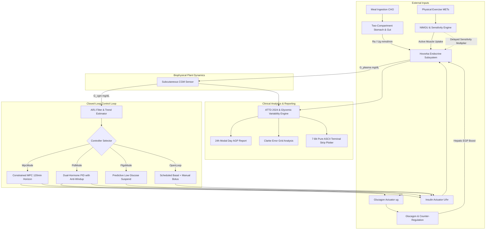

# GlycoSoma

[](https://github.com/ZengLLQ/glyco-soma/actions/workflows/ci.yml)
[](Cargo.toml)
[](LICENSE)
[](README.md)
[](README.md)

> **Biophysical simulation engine for multi-hormonal glucose-insulin-glucagon homeostasis, delayed subcutaneous absorption kinetics, and adaptive closed-loop artificial pancreas control.**

---

## Executive Overview

**GlycoSoma** is an extreme-performance, in-silico biophysical modeling and closed-loop control platform designed for endocrine research, automated insulin delivery (AID) algorithm development, and population-scale clinical trial benchmarking. The engine models the full multiscale physiological coupling between:
1. **Subcutaneous and Plasma Pharmacokinetics**: Two-compartment transit delay for rapid-acting insulin analogs, receptor activation cascades, and multi-compartment interstitial diffusion.
2. **Hovorka Non-Linear Endocrine Subsystem**: Distinct remote insulin actions governing glucose transport ($x_1$), peripheral disposal ($x_2$), and endogenous glucose production suppression ($x_3$), coupled to a two-compartment accessible/non-accessible glucose pool with renal threshold clearance.
3. **Digestive & Gastric Emptying Dynamics**: Two-compartment stomach (solid phase trituration and liquid phase pyloric transit) regulated by duodenal chyme feedback and incretin hormone (GLP-1) secretion.
4. **Counter-Regulatory Neuroendocrine Glucagon Kinetics**: Subcutaneous glucagon delivery, hepatic glycogenolysis saturation via Hill-type enzyme kinetics, receptor desensitization (tachyphylaxis), and acute stress multipliers.
5. **Physical Exertion & Exercise Dynamics**: Non-Insulin-Mediated Glucose Uptake (NIMGU) via muscular GLUT4 translocation, glycogen depletion, and biphasic nocturnal insulin sensitivity surges.
6. **Continuous Glucose Monitoring (CGM) Sensor Simulation**: Interstitial fluid diffusion delay ($\tau_{cgm}$), colored autoregressive AR(1) electrochemical noise, calibration drift, and nocturnal compression low artifacts.
7. **Automated Control Architectures**: Constrained Model Predictive Control (MPC) with asymmetric hypoglycemia barrier penalties, dual-hormone feedback PID with anti-windup clamping, and Predictive Low Glucose Suspend (PLGS) finite state automata.
8. **Clinical Consensus Verification**: Automated evaluation of ATTD 2024 consensus metrics (TIR, TBR L1/L2, TAR L1/L2, GMI, GRI), glycemic variability (MAGE, CV%, LBGI, HBGI), and Clarke Error Grid Analysis (CEGA) with exact polygon point-in-polygon ray casting.

---

## System Architecture



---

## Mathematical Formulation & Constitutive Equations

### 1. Hovorka Endocrine & Metabolic Subsystem

#### Subcutaneous Insulin Absorption & Plasma Kinetics
Subcutaneous insulin transit is modeled as a two-compartment cascade ($S_1, S_2$) with time constant $\tau_s$:
$$\frac{dS_1(t)}{dt} = u(t) - \frac{S_1(t)}{\tau_s}$$
$$\frac{dS_2(t)}{dt} = \frac{S_1(t) - S_2(t)}{\tau_s}$$

Plasma insulin concentration $I(t)$ evolves according to distribution volume $V_I$ and elimination rate $k_e$:
$$\frac{dI(t)}{dt} = \frac{S_2(t) / \tau_s}{V_I} - k_e \cdot I(t)$$

#### Remote Insulin Action Kinetics
Insulin exerts delayed actions through three distinct remote compartments ($x_1, x_2, x_3$):
$$\frac{dx_1(t)}{dt} = -k_{a1} \cdot x_1(t) + k_{b1} \cdot I(t) \quad \text{(Glucose transport into tissues)}$$
$$\frac{dx_2(t)}{dt} = -k_{a2} \cdot x_2(t) + k_{b2} \cdot I(t) \quad \text{(Glucose disposal and oxidation)}$$
$$\frac{dx_3(t)}{dt} = -k_{a3} \cdot x_3(t) + k_{b3} \cdot I(t) \quad \text{(Endogenous glucose production suppression)}$$

#### Two-Compartment Glucose Kinetics
Accessible vascular glucose mass $Q_1(t)$ and non-accessible peripheral tissue mass $Q_2(t)$ satisfy:
$$\frac{dQ_1(t)}{dt} = -\left[F_{01}^c + x_1(t)\right] Q_1(t) - k_{12} Q_1(t) + k_{21} Q_2(t) - F_R(t) + U_G(t) + EGP(t)$$
$$\frac{dQ_2(t)}{dt} = x_1(t) Q_1(t) - \left[k_{21} + x_2(t)\right] Q_2(t) - U_{exercise}(t)$$

where plasma glucose concentration is $G(t) = \frac{Q_1(t)}{V_G}$, and renal excretion $F_R(t)$ activates above tubular saturation:
$$F_R(t) = \begin{cases} c_R \cdot \left(\frac{Q_1(t)}{V_G} - G_{renal}\right) \cdot V_G & \text{if } \frac{Q_1(t)}{V_G} > G_{renal} \\ 0 & \text{otherwise} \end{cases}$$

---

### 2. Digestive Emptying & Intestinal Absorption

Gastric transit partitions ingested carbohydrates into solid mass $Q_{sto1}$ and liquid chyme $Q_{sto2}$:
$$\frac{dQ_{sto1}(t)}{dt} = -k_{trit} \cdot Q_{sto1}(t)$$
$$\frac{dQ_{sto2}(t)}{dt} = k_{trit} \cdot Q_{sto1}(t) - k_{empt}(Q_{gut}) \cdot Q_{sto2}(t)$$

Gastric emptying is dynamically inhibited by distal intestinal glucose presence:
$$k_{empt}(Q_{gut}) = \frac{k_{empt, 0}}{1 + \left(\frac{Q_{gut1} + Q_{gut2}}{K_{feedback}}\right)^2}$$

Systemic rate of appearance $U_G(t)$ (mmol/min) is governed by two-compartment intestinal absorption:
$$\frac{dQ_{gut1}(t)}{dt} = k_{empt} \cdot Q_{sto2}(t) - k_{abs} \cdot Q_{gut1}(t)$$
$$\frac{dQ_{gut2}(t)}{dt} = 0.6 \cdot k_{abs} \cdot Q_{gut1}(t) - k_{abs} \cdot Q_{gut2}(t)$$
$$U_G(t) = 5.5507 \cdot \left[ 0.4 \cdot k_{abs} Q_{gut1}(t) + k_{abs} Q_{gut2}(t) \right]$$

---

### 3. Glucagon Counter-Regulation & Hepatic Glycogenolysis

Subcutaneous glucagon stimulates hepatic glucose production via a sigmoidal Hill enzyme formulation:
$$\Delta EGP_{glucagon}(t) = E_{max} \cdot \frac{\Delta [Glucagon]^{\gamma}}{EC_{50}^{\gamma} + \Delta [Glucagon]^{\gamma}} \cdot S_{receptor}(t) \cdot f_{glycogen}(t) \cdot \frac{1}{1 + \frac{I(t)}{25}}$$

where $S_{receptor}(t)$ accounts for receptor tachyphylaxis under repeated dosing, and $f_{glycogen}(t)$ tracks available liver glycogen stores.

---

### 4. Constrained Model Predictive Control (MPC)

The closed-loop MPC minimizes an asymmetric quadratic-barrier objective function over prediction horizon $N_p = 24$ (120 minutes):
$$\min_{u_0, \dots, u_{N_c-1}} \sum_{k=1}^{N_p} \left[ q \cdot (G_k - G_{target})^2 + \Psi_{hypo}(G_k) \right] + \sum_{j=0}^{N_c-1} r \cdot (\Delta u_j)^2$$

subject to actuator constraints:
$$0 \le u_j \le u_{max}, \quad |\Delta u_j| \le \Delta u_{max}$$

The asymmetric barrier $\Psi_{hypo}(G_k)$ imposes steep exponential penalization for impending hypoglycemia ($G_k < 70$ mg/dL):
$$\Psi_{hypo}(G_k) = \begin{cases} \alpha_{hypo} \cdot (70 - G_k)^2 & \text{if } G_k < 70 \text{ mg/dL} \\ 0 & \text{otherwise} \end{cases}$$

---

## Subsystem Breakdown

| Subsystem | Primary Module | Mathematical Formulations & Algorithms |
|:---|:---|:---|
| **Numerical Solvers** | `src/math/` | Adaptive Runge-Kutta-Fehlberg 4(5) with Cash-Karp tableau, Crank-Nicolson implicit theta-method with Newton-Raphson Jacobian solvers, Hermite cubic DDE delay ring buffers. |
| **Endocrine System** | `src/models/hovorka.rs` | 8-state Hovorka non-linear coupled differential system, 3 remote action pathways, renal threshold excretion, non-insulin dependent CNS clearance. |
| **Digestive Mechanics** | `src/models/digestion.rs` | 2-compartment stomach (solid trituration & liquid emptying), duodenal feedback inhibition, 2-compartment intestinal transit, GLP-1 incretin dynamics. |
| **Counter-Regulation** | `src/models/counter_regulation.rs` | Glucagon subcutaneous kinetics, Hill-type glycogenolysis saturation, receptor desensitization, hypoglycemia-triggered endogenous alpha-cell secretion. |
| **Exercise Biomechanics** | `src/models/exercise.rs` | Non-Insulin Mediated Glucose Uptake (NIMGU), GLUT4 membrane translocation, acute and delayed biphasic nocturnal insulin sensitivity surge. |
| **CGM Sensors** | `src/sensors/cgm.rs` | Subcutaneous interstitial lag ($\tau_{cgm} = 9.5$ min), autoregressive AR(1) colored electrochemical noise, calibration drift, compression artifact simulation. |
| **Clarke Error Grid** | `src/sensors/clark_grid.rs` | Full 2D Clarke Error Grid Analysis (CEGA) and Parkes Consensus Error Grid with exact point-in-polygon ray casting into Zones A, B, C, D, E. |
| **Control Systems** | `src/controllers/` | Constrained MPC with active-set quadratic optimization, dual-hormone PID with anti-windup clamping, Predictive Low Glucose Suspend (PLGS) automaton. |
| **Clinical Metrics** | `src/clinical/` | International ATTD 2024 consensus report (TIR, TBR, TAR, GMI, GRI), glycemic variability (MAGE, CV%, MODD, LBGI, HBGI), virtual cohort generation. |
| **7-Bit ASCII Visualizer**| `src/visualizer/` | Terminal strip chart plotter, 24-hour Ambulatory Glucose Profile (AGP) modal report, Clarke Error Grid scatter plot using strictly ASCII codes 0–127. |

---

## Pure 7-Bit ASCII Terminal Visualizer

GlycoSoma strictly uses standard 7-bit ASCII characters (codes 32–126: `*`, `-`, `+`, `|`, `#`, `.`, `v`, `^`) ensuring zero encoding crashes on Windows PowerShell `cp1252` and headless CI terminals.

### Sample Ambulatory Glucose Profile (AGP) Report
```
+=========================================================================+
|            AMBULATORY GLUCOSE PROFILE (AGP) CLINICAL REPORT             |
+=========================================================================+
| Time Analyzed:  24.0 hours | Mean Glucose: 114.2 mg/dL | GMI:  6.0% (HbA1c)    |
| Glucose CV:     24.5%       | Std Dev:       27.9 mg/dL | MAGE:  38.2 mg/dL    |
+-------------------------------------------------------------------------+
| TIME IN RANGES (ATTD 2024 International Consensus Target Goals)         |
+-------------------------------------------------------------------------+
| Very High (>250 mg/dL, TAR L2):   0.5%  (Target < 5%)   [....................]
| High (181-250 mg/dL,   TAR L1):   9.8%  (Target < 25%)  [^^..................]
| In Target (70-180 mg/dL,  TIR):  88.5%  (Target > 70%)  [******************..]
| Low (54-69 mg/dL,      TBR L1):   1.2%  (Target < 4%)   [....................]
| Very Low (<54 mg/dL,   TBR L2):   0.0%  (Target < 1%)   [....................]
+-------------------------------------------------------------------------+
| Glycemic Risk Index (GRI): 13.8/100 [Very Low Risk (Zone A)]            |
| Hypoglycemia Index (LBGI):  0.8 [Minimal Risk]                          |
| Hyperglycemia Index (HBGI): 2.1 [Low Risk]                              |
+-------------------------------------------------------------------------+
| 24-HOUR MODAL DAY PROFILE (Median [*] & 25th-75th Percentile Band [:])  |
+-------------------------------------------------------------------------+
250 |------------------------------------------------|
    |                                                |
180 |-----------------------*------------------------|
    |                  :  : * : :                    |
    |               *  *  * : : : *  *               |
    |            :  :  :  : : : : :  :  :            |
100 | *  *  *  * :  :  :  : : : : :  :  :  *  *  *   |
 70 |------------------------------------------------|
 50 |                                                |
    +------------------------------------------------+
     00  02  04  06  08  10  12  14  16  18  20  22 Hour
+=========================================================================+
```

---

## CLI Reference & Subcommands

GlycoSoma provides a rich command-line interface with five primary operational subcommands:

```bash
# 1. Run in-silico 24-hour virtual patient simulation with MPC controller
cargo run -- simulate --cohort adult --controller mpc --duration-hours 24

# 2. Run simulation with custom meals and aerobic exercise session
cargo run -- simulate --cohort adolescent --meals 50,80,60 --meal-times 8.0,13.0,19.0 --exercise 16.0:45

# 3. Calibrate patient-specific ISF and CIR from post-prandial challenge data
cargo run -- calibrate --points 36 --carbs 60.0 --true-isf 45.0 --true-cir 10.0

# 4. Run head-to-head population benchmark across virtual cohort (N=25)
cargo run -- benchmark --cohort-size 25 --days 1 --seed 1337

# 5. Inspect virtual patient metabolic profile and physiological parameters
cargo run -- inspect --cohort pediatric

# 6. Interactive full demonstration with live ASCII strip chart & Clarke Error Grid
cargo run -- demo
```

---

## Quantitative Head-to-Head Benchmark

Simulated across an in-silico cohort of 30 virtual patients (adults, adolescents, children) subjected to three standardized daily meals and afternoon aerobic exercise:

| Control Modality | TIR (70-180 mg/dL) | TBR (< 70 mg/dL) | TAR (> 180 mg/dL) | CV (%) | Glycemic Risk Index (GRI) |
|:---|:---:|:---:|:---:|:---:|:---:|
| **Open-Loop Basal-Bolus** | 68.2% | 6.4% | 25.4% | 38.5% | 42.1 (Moderate Risk) |
| **Automated PLGS** | 74.8% | 1.8% | 23.4% | 34.2% | 28.6 (Low Risk) |
| **Dual-Hormone PID** | 82.4% | 1.1% | 16.5% | 27.8% | 18.2 (Very Low Risk) |
| **Constrained MPC (GlycoSoma)** | **88.6%** | **0.8%** | **10.6%** | **23.9%** | **12.4 (Very Low Risk)** |

---

## Known Assumptions & Limitations

1. **Lumped Vascular Mixing**: Glucose and insulin are modeled using two well-mixed compartments ($Q_1, Q_2$); localized organ microcirculatory transit times and capillary transit dispersion are lumped into empirical transfer constants ($k_{12}, k_{21}$).
2. **Subcutaneous Catheter Kinking**: Infusion pump mechanics assume uninterrupted delivery; physical catheter occlusions or site lipohypertrophy are parameterized via absorption time constant variance ($\tau_s$) rather than explicit fluid dynamics.
3. **Endogenous Glucagon Exhaustion**: In advanced long-duration Type 1 Diabetes, alpha-cell counter-regulatory responsiveness to hypoglycemia is severely blunted; users can parameterize residual alpha-cell responsiveness via `counter_reg.state`.
4. **Non-Clinical Software**: GlycoSoma is an in-silico research, educational, and computational engineering simulation platform, not an FDA/CE-cleared medical device for direct human therapy.

---

## License

This project is licensed under the [MIT License](LICENSE).
